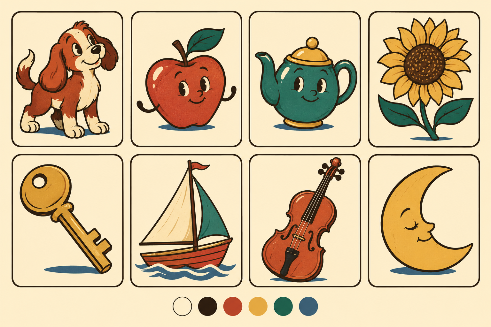

# Game pictures — approved retro direction (#323)

The owner approved this original retro illustrated-card direction on 2026-10-27.
This supersedes the initial generic-flat proposal and the paper-cut exploration.
Jev 021 is evidence; the owner decides. The Card Table layout stays; app styling
is #336 and the icon/wordmark is #337. Illustration batches #325–#328 stay asset-only.

This is the approved **visual reference**, not a shipping asset sheet. The
direction needs no second approval.

## Samples (#323, completed 2026-10-28)

Eight individual samples live beside the reference: `dog.png`, `apple.png`,
`teapot.png`, `sunflower.png`, `key.png`, `sailboat.png`, `violin.png`,
`moon.png` (transparent 600×600 PNG, ≤120 KB each). `sheet.png` shows the same
files on cream (`#FFF1D0`) and dark-surround (`#211E1B`) tiles and in
grayscale, at 100pt and at Name the Herd's actual 52pt. All eight stay
recognizable unnamed at 52pt, stay distinct in grayscale, and keep a visible
outline on both tiles. Exact prompts are in `art-samples/prompts/`; provenance
is in [ip-clearance.md](../ip-clearance.md#ai-generated-pictures). Batches
#325–#328 copy this sheet; they do not reinterpret it.

## Look and palette

- Original vintage rubber-hose curves and mid-century print colors: bold espresso
  contours, fluid C/S shapes, restrained exaggeration, familiar silhouettes.
- One centered object fills about 80% of its square, viewed from its clearest
  recognizable angle. A bicycle may be side-on; a violin must differ from a guitar.
- At most four flat fills per picture. Selective subtle faces add warmth; most
  recognition comes from the object's shape. Keep detail consistent across the set.
- Game tiles have clean interiors: no fine grain, tiny decorations, gradients,
  text, numbers, logos, recognizable characters or copied poses/compositions.
- Use the same cutout in light and dark. Its dark outline must stay visible on
  both real tile backgrounds; a thin cream separation edge is an option to test.

| Token | Hex | Role |
|---|---|---|
| Cream | `#FFF1D0` | Light surface / illustration separation |
| Espresso | `#2B2118` | Ink and primary text |
| Dark tomato | `#AF3F32` | Warm emphasis |
| Honey mustard | `#E7AC45` | Accent fill with espresso text |
| Muted jade | `#246456` | Brand/action connection |
| Faded blue | `#35566D` | Secondary accent |
| Dark surround | `#211E1B` | Candidate dark-mode surface |

Calculated text contrast on cream: espresso 14.06:1, tomato 5.24:1, jade 6.18:1,
blue 6.93:1. Mustard is not text on cream (1.81:1); espresso on mustard is 7.79:1.
Cream on the dark surround is 14.80:1. These candidate pairs do not replace
verification of actual screens in #336 or mechanically correct game colors.

## Fixed production prompt

Use this paragraph unchanged, followed by the catalogue object's description.
Record the complete submitted prompt, date and actual tool disclosure in
`docs/art-prompts.md`. Do not name an artist, studio, brand, game or app in a
generation prompt, and do not supply third-party source images.

> Original vintage cartoon game illustration of <object>. One familiar object,
> centered, occupying about 80% of a square, shown from its clearest recognizable
> angle. Bold warm espresso ink contours, fluid C/S curves, restrained elastic
> proportions, a strong unmistakable silhouette and at most four flat fills from
> cream, dark tomato, honey mustard, muted jade and faded blue. A subtle friendly
> face only when specified in the object description. Clean simple interior
> shapes that remain legible at 52pt. Transparent background, no scenery or card
> frame. Keep the outline distinguishable on both cream and dark tiles; a thin
> cream separation edge may surround dark outer contours. No grain, gradients,
> tiny detail, text, numbers, logos, signature accessories, recognizable existing
> characters, copied poses or compositions. Original design, no source tracing.

## Files and checks

- Production: transparent 600×600 PNG, ≤120 KB; one universal single-scale
  `pic.<slug>.imageset` under `MenteViva/Assets.xcassets/Pictures/`. Folder
  `Contents.json` has no namespacing. Samples stay in `docs/design/art-samples/`.
- Eight samples: dog, apple, teapot, sunflower, key, sailboat, violin, moon.
- Review at 100pt **and actual game sizes**: Name the Herd uses 52pt; Memory Lane
  uses half the shorter card side. A 100pt tile does not imply a 100pt picture.
- Check complete game sets, including shared pictures and decoys, in grayscale
  and on actual light/dark tile backgrounds. Use the same image in every row.
- Verify PNG size/alpha/weight, catalogue names, EN/ES VoiceOver labels and actual
  asset display in a simulator. Owner approval of the concept does not establish
  these technical checks or legal clearance; retain #226's review.

Provenance: [AI-generated pictures](../ip-clearance.md#ai-generated-pictures).
Exact approved concept prompt: [reference prompt](art-samples/retro-direction-approved.prompt.txt).

## App tokens (#336)

Implemented in `MenteViva/Theme.swift` as semantic light/dark colors. Views use
the token, never the hex. Each game keeps its own `GameID.ink`; all 13 still
pass 4.5:1 on cream (lowest 4.77:1) and on the dark surround.

| Token | Light | Dark | Use |
|---|---|---|---|
| `paper` | `#FFF1D0` | `#211E1B` | Page behind games, every card/tile/panel face. Replaces `systemBackground` |
| `espresso` | `#2B2118` | `#FFF1D0` | Card outlines (2pt) and outline buttons (hard print shadows are 25% black) |
| `brand` | `#246456` | `#78C4AE` | App tint, primary button fill; label is `paper` (6.2:1 / 8.1:1) |
| `amber` (mustard) | `#E7AC45` | `#E7AC45` | Fill only: played tick, stamp, "Almost" wash (24%). Never text on paper |
| `onAmber` | `#2B2118` | `#2B2118` | Text/tick on mustard (7.8:1) |
| `tomato` (`todaysPick`) | `#AF3F32` | `#F5A290` | Warm emphasis text, incl. on the mustard wash (4.56:1 / 5.0:1) |
| `fadedBlue` | `#35566D` | `#9DBBD3` | Secondary action labels (6.9:1 on cream) |
| `table` gradient | `#246456` → `#7FA58F` → `#E7AC45` | `#123F3C` → `#2D4A3F` → `#6A5024` | Home's table and the celebration backdrop; only cards sit on it, no text |

Usage rules:

- Answer colors (Color Clash word, shape and swatches) are mechanics, not theme: the
  stimulus keeps the system background plate it was checked on. Tile Pairs tiles use `paper`.
- Selection and completion keep a shape cue (tick, thick outline); color is never the only signal.
- Mustard is never text on paper. Headings stay native New York (`.serif`), controls SF Rounded.
- `ContrastTests` checks the text pairings above in both modes at 4.5:1; outlines and the `table` gradient carry no text and are not tested.
