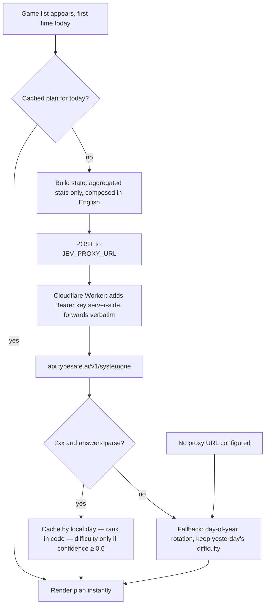

# Jev integration — MenteViva

Jev is **seasoning, not the meal**. All five games are 100% deterministic and work offline.
Jev answers two narrow questions per day; code stays in control of everything else.

Source of truth: https://docs.typesafe.ai/llms.txt (fetched 2025; append `.md` to doc paths).

## Status (2026-09-29)

| Piece | State |
|---|---|
| `JevService` client + plan policy + unit tests | Done (top-3-of-5 mix, confidence-gated difficulty, day-stamp cache, fallback) |
| Wired into the running app | **No.** Nothing builds `PlayerStateSummary` or calls `dailyPlan()`; Home shows all 5 games in fixed order. In progress: #58 (record accuracy), #59 (Home wiring), #60 (apply difficulty in games) |
| Client hardening | Pending #61: one bad answer currently fails the whole decode (see Failure behavior) |
| Live verification | Ad-hoc calls only (`jev-json/000`–`010`, model `jev-1.13.0`, decision questions with different key names, e.g. `include_math`). The shipped 10-question payload has never been sent live or archived: #62 |
| Proxy | `proxy/worker.js` exists; hardening and real deploy: #63 |
| Per-game 10-session trend in the state | Not built. State is one 14-day summary per game (below) |

## The daily judgment at a glance

One lazy request per local day; every failure path lands silently on the
deterministic fallback. The UI never waits on the network.



## API contract used

- `POST https://api.typesafe.ai/v1/systemone`
- Header: `Authorization: Bearer <TYPESAFE_AI_KEY>`
- Body: `{ "state": <string|object>, "model": "jev-latest", "questions": { "<key>": {...} } }`
- One request can mix Choice / Score / Noul questions; all see the same state and are
  evaluated independently. We send **one request per day** with 10 questions (5 games × 2).
- Answers (verified live): `choice` → `{type, choice, probabilities, confidence}`;
  `score` → `{type, score (float, e.g. 1.93), legend (object keyed by level),
  probabilities (object keyed by level), confidence}`;
  `noul` → `{type, noul (P(yes), 0..1)}` — **no confidence field on Noul**.
- Real observed values: score float `1.7`–`1.93`, legend echoing our criteria verbatim,
  probabilities summing to ~1.0, `usage: {input_tokens, output_tokens}` on every response
  (001: 890 in / 95 out). Client ignores `usage` today.
- `confidence` (0..1) is derived from the probability distribution's shape; it's a
  separate axis from the answer itself. Gate actions on it.

## Judgment 1 — daily game mix (5 × Noul)

- **Primitive:** five Noul questions, one per game, keyed `include_<GameID.rawValue>`:
  `include_memory_match`, `include_stroop`, `include_category_fluency`,
  `include_math_streaks`, `include_quick_eyes`.
- **Instructions:** "Should <game> be included in today's recommended mix for this player?"
  with `criteria.true/false` pinning what "should" means (variety, recency, engagement).
- **State:** compact JSON object keyed by game: `sessionsLast14Days`, `meanAccuracy`,
  `meanRoundsCompleted`, `daysSinceLastPlayed`, `currentDifficulty`. No dates, no names,
  no identifiers. `meanAccuracy` cannot be derived yet: sessions store no accuracy (#58).
- **Why Noul and not Choice:** the mix is multi-select (3 of 5 games). A single Choice
  forces one winner; independent Nouls give a per-game probability we rank in code.
- **Policy in code:** sort games by `noul` descending, take the top 3 of 5. This guarantees a
  non-empty mix even if every probability is low — the model ranks, code decides.
- **Fallback:** deterministic rotation — day-of-year offset over the game list, top 3.

## Judgment 2 — per-game difficulty (5 × Score)

- **Primitive:** five Score questions, one per game, keyed `difficulty_<GameID.rawValue>`, three levels.
- **Levels (criteria, ordered):**
  0 = "Easy — player is struggling or accuracy dropped recently; reduce cognitive load"
  1 = "Medium — player is steady; maintain current challenge"
  2 = "Hard — player consistently succeeds quickly; increase challenge"
- **State:** the same 14-day summary as Judgment 1. A per-game last-10-session trend was
  planned and is **not built**.
- **Mapping:** `score` is a float; code rounds to the nearest level (0.49 → easy,
  1.5 → hard). `score` outside [0, 2] is clamped.
- **Confidence gate:** apply the new difficulty only when `confidence ≥ 0.6`.
  Wrong difficulty is the high-stakes error for this audience (frustration → abandonment),
  so the threshold sits above the docs' 0.5 "genuinely unsure" floor. Below threshold:
  keep yesterday's difficulty. Initial difficulty for a new player is always **medium**.
- **Fallback:** keep current stored difficulty.

## Timing — when judgments fire

Once per local day, lazily, on first appearance of the game list. Both judgments ride in
**one HTTP request** (5 Nouls + 5 Scores against one state object). The result is cached
in `UserDefaults` with the local day stamp; a cached plan for today is reused without a
network call. Nothing blocks the UI — the home screen renders the cached/default plan
immediately and updates in place if Jev answers.

Not after each session: difficulty that shifts mid-day feels erratic to older adults,
and per-session calls multiply cost 4–6× for no benefit at this granularity.

## Offline / failure behavior

Every failure path degrades to the deterministic fallback, silently (convention 5 —
no error copy, ever):

1. No network / timeout (10 s) → fallback plan.
2. Proxy or API error (non-2xx) → fallback plan.
3. Malformed response → fallback plan. Today the whole `answers` map decodes at once, so
   one unknown or malformed answer discards the good ones too; per-answer tolerance is #61.
   Missing keys are handled: a missing Noul sorts last, a missing Score keeps current difficulty.
4. Low confidence on a difficulty Score → keep current difficulty.
5. No proxy URL configured → service is inert; fallback plan always.

## Cost / latency

- 1 request/day/user, ~10 questions, state ≈ 300–500 input tokens, answers ≈ 50–100
  output tokens. Negligible cost; Jev is a small fast model, typical latency < 1 s,
  off the critical path anyway (cached plan renders first).
- ES/EN note: state is always composed in English (Jev's primary training language;
  docs note lower accuracy for other languages). Locale never reaches the request.

## Privacy — what leaves the device

The state object contains only **aggregated gameplay statistics**: game IDs, session
counts, accuracy ratios, round counts, "days since played". No name, age, exact dates,
device identifiers, free text, or health claims. The proxy adds the API key server-side;
the device never holds it. If we later add CloudKit sync, this state shape stays the
same — sync changes storage, not what Jev sees.

## Server-side proxy requirement

An iOS app cannot hold `TYPESAFE_AI_KEY` safely (extractable from the binary —
convention 7: server-side proxy before public release). `JevService` therefore posts the
identical request body to a **configurable proxy URL** (`JEV_PROXY_URL` in Info.plist /
xcconfig; unset → offline fallback). Reference implementation: `proxy/worker.js`
(small Cloudflare Worker; deploy guide in `proxy/README.md`; hardening tracked in #63):

```
POST /jev  →  forward body to https://api.typesafe.ai/v1/systemone
              with header Authorization: Bearer $TYPESAFE_AI_KEY
              return response verbatim
```

No request rewriting, no body logging, rejects anything but `POST /jev`. It has no
caller auth, rate limit or size cap yet, so it must not be deployed as-is (#63). The app
code does not change when the proxy goes live — only the config value does. During
local beta, run the same worker locally (`npx wrangler dev`, key from the environment).
