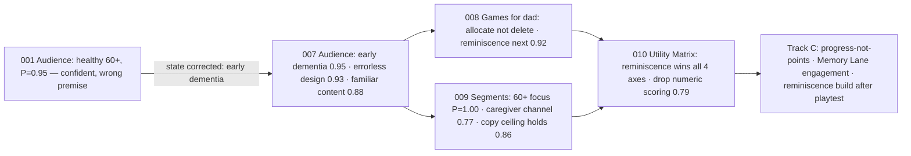

# Jev decision revisit — 2026-09-19

The 5 product decisions from the human interview (decisions.md) re-asked as real
Jev judgments against a compact evidence/constraints state. Raw request/response
pairs: `jev-json/001`–`005`. Smoke test: `jev-json/000`. Model served: jev-1.13.0.
Jev output is evidence, not truth — policy stays with us.

## Judgment lineage

Each judgment inherits the corrected state of the ones before it — 001's
confident wrong answer is the root lesson of this file.

## 001 — Audience (`jev-json/001-audience.*`)

| | |
|---|---|
| Our call | Healthy-to-mild older adults, preventive focus; not diagnosed MCI in v1 |
| Jev | **Choice:** `healthy_preventive_60plus` — P=0.95, confidence 0.94 (MCI 0.05, dementia 0.0, general 0.0). **Noul** "dementia claims evidence-unsupported + regulatorily risky": **0.98** |
| Verdict | **Agree** — full alignment |
| Read | The evidence+regulatory framing makes this a near-consensus call; MCI stays a revisit trigger, not a v1 target. |

## 002 — Game domains (`jev-json/002-game-domains.*`)

| Domain | Score (0=skip, 1=variety, 2=pillar) | Confidence | Verdict vs our 4 games at the time (Quick Eyes since added) |
|---|---|---|---|
| processing_speed | **1.93** | 0.89 | **Tension** — we don't cover it |
| working_memory | 1.79 | 0.69 | Agree (covered by Memory Lane) |
| episodic_memory | 1.70 | 0.54 | Agree (covered by Memory Lane) |
| executive_inhibition | 1.34 | 0.43 | Agree-ish (Color Clash = variety-plus) |
| verbal_fluency | 0.81 | 0.67 | Agree (Name the Herd = variety) |
| numeracy | **0.62** (P(skip)=0.39) | 0.41 | **Notable** — weakest domain; Jev leans skip/variety |

- Read: Jev ranks processing speed the only slam-dunk pillar and treats numeracy
  as the most dispensable — our lineup is defensible but inverted on the
  strongest evidence. The speed gap is already a known open question
  (decisions.md); Jev strengthens it.

## 003 — Monetization (`jev-json/003-monetization.*`)

| | |
|---|---|
| Our lean | One-time $12.99 + Family Sharing (open question, not yet decided) |
| Jev | **Choice:** `one_time_1299_family_sharing` — P=0.72, confidence **0.62**; freemium_annual_2499 P=0.28 |
| Verdict | **Agree, low conviction** |
| Read | Right answer, but 0.28 on freemium-annual is a real minority report — keep the "revisit after family beta" trigger exactly as written. |

## 004 — Jev role (`jev-json/004-jev-role.*`)

| | |
|---|---|
| Our call | Offline-first; Jev once daily; never per-session |
| Jev | **Noul** offline-first + once-daily is right: **0.90**. **Noul** per-session worth cost + mid-day shifts: **0.17** |
| Verdict | **Agree** — both directions |
| Read | The architecture decision is validated on the exact axis we cared about (facility wifi, erratic feel, 4–6× cost). |

## 005 — v0.2.0 priority (`jev-json/005-v2-priority.*`)

| | |
|---|---|
| Our lean | None recorded; open question listed speed game as "candidate for fifth game" |
| Jev | **Choice:** `polish_existing_from_playtest` — P=0.99, confidence **0.98** (speed game 0.01, family 0.0, breadth 0.0) |
| Verdict | **Notable** — strongest signal of the whole batch |
| Read | Given "no playtest data exists," Jev says the speed game waits: playtest first, then decide. This reorders my intuition (evidence-first → speed game next). |

## Candidate tickets (genuine tensions only)

1. **Playtest before fifth game.** Jev 005 (P=0.99) says v0.2.0 = playtest-driven
   polish. Action: schedule 3–5 sessions with ES/EN seniors 65+ before scoping
   any new game. The processing-speed game becomes the default *next* candidate,
   gated on playtest outcome — consistent with 002's 1.93 pillar score.
2. **Numeracy justification check.** Jev 002 scores numeracy 0.62 with P(skip)=0.39.
   Cheap ticket: define what Number Trail is *for* (engagement variety vs
   evidence domain) and let playtest data (ticket 1) confirm or cut it.

No ticket for monetization: Jev agrees with our lean; the 0.28 freemium
minority is already covered by the existing "revisit after family beta" trigger.

## 007 — Audience re-asked (corrected state) — 2026-09-20

The original 001 call assumed "healthy preventive 60+". The owner later stated
the real player has early-stage dementia. Same model, same question shape,
corrected state — and the answer flips (raw pair: `jev-json/007-audience-dementia.*`).

| Judgment | 001 | 007 |
|---|---|---|
| Primary audience | healthy_preventive_60plus | **mci_early_dementia** (0.95, conf 0.94) |
| Design | — | errorless/familiarity over speed (0.93) |
| Content | — | familiar/personalized matters (0.88) |

Lesson recorded as a rule in docs/question-audit.md: the question and its
implicit state are the decision; a confident answer to the wrong premise is the
most expensive failure mode we have.

## 008 — Games re-scored for early dementia — 2026-09-20

Same five games, re-scored against the corrected audience (early dementia,
errorless/familiarity priority). Raw pair: `jev-json/008-games-dementia.*`.
Score legend: 0 = deprioritize, 1 = keep, 2 = core.

| Game | Score | Confidence | Verdict |
|---|---|---|---|
| Memory Lane (pairs) | 1.76 | .64 | keep, leaning core |
| Name the Herd (category) | 1.27 | .16 | keep — Jev genuinely unsure (14/44/42) |
| Color Clash (Stroop) | 0.24 | .65 | deprioritize — error-*inducing* by design |
| Number Trail (math) | 0.12 | .83 | deprioritize |
| Quick Eyes (speed) | 0.01 | .98 | deprioritize — timed pressure, worst fit |
| Next game = reminiscence/familiarity | 0.92 (Noul) | — | strongly indicated |

**Key reconciliation:** the three games Jev deprioritizes for *dad* are exactly
what a healthy 40-something wants — speed, logic, attention. So nothing is
deleted: the five games get **allocated to the right person**, which is the
per-person library (Q2 answer C) made concrete. Dad's library = Memory Lane +
Name the Herd + a new reminiscence game; the speed/logic/attention games serve
mom and the owner.

Still gated: any *rebuild* or *new game* waits on dad's playtest (#6, gate #18).
This is a candidate list, not a work order.

## 009 — Segment prioritization — 2026-09-22

Owner opened the design to 3 segments (60+, mental-health, wellness) — question
from question-audit re-litigated with cited market state from
`docs/research-2026-09-22.md`. Raw pair: `jev-json/009-segment-priority.*`.
Real question asked: where does *design and copy focus* go (one binary, no code
forks) — not "which market is biggest."

| Judgment | Result | Verdict |
|---|---|---|
| Primary design/copy focus | **older_adults_60plus** — P=1.00, confidence 1.00 (mental-health 0.0, wellness 0.0) | **Agree** — maximal signal, matches dad-first product truth |
| Sell to the caregiver buyer | **Noul 0.77** | **Agree** — marketing/payflow addresses the adult child; player never sees a pitch |
| Copy ceiling unchanged under expansion | **Noul 0.86** | **Agree** — wider audience *raises* the value of the wellness line |

Read: the 3-segment expansion resolves to "S1 focus, S2/S3 served as spillover
of the same product" — exactly what the research said (S2 = regulatory gravity
+ no design freedom; S3 = no edge). Expansion changes the *store listing and
welcome copy* (who it's for), not the app. Action feeding Track C/D: App Store
copy and onboarding speak to the adult child ("for someone you love"); in-app
copy speaks to the player, warm and claim-free. No decision changes; this
locks the audience question for good — question-audit closeout in Track B
records it in decisions.md.

## 010 — Game Utility Matrix — 2026-09-22

Six games (5 shipped + reminiscence candidate) × 4 dimensions, scored 0–2 for
the whole household (dad + mom/owner). Raw pair: `jev-json/010-game-utility-matrix.*`.
Cell = score/confidence. polish = closeness to the v0.2.0 visual/a11y bar
(higher = less work).

| Game | evidence | errorless (dad) | engagement | polish |
|---|---|---|---|---|
| **Reminiscence (candidate)** | 1.58/.37 | **1.82/.73** | **1.17/.30** | **1.56/.34** |
| Memory Lane (pairs) | 1.66/.49 | 1.24/.60 | 0.50/.26 | 0.75/.38 |
| Name the Herd (category) | 0.46/.31 | 0.95/.86 | 0.52/.25 | 0.73/.53 |
| Quick Eyes (speed) | **1.91/.87** | 0.19/.71 | 0.12/.82 | 0.22/.67 |
| Color Clash (Stroop) | 0.85/.39 | **0.02/.97** | 0.12/.82 | **0.08/.88** |
| Number Trail (math) | **0.02/.96** | 0.51/.23 | **0.06/.91** | 0.26/.61 |

Nouls: reminiscence ships licensing-free on family photos **0.74**; drop
numeric scoring for progress/streaks **0.79**.

Reads:

1. **Reminiscence is the only game that wins on all four axes** — best
   errorless fit (1.82), best engagement (1.17), cheapest to reach the bar
   from zero (1.56), and licensing-free (0.74). It is the v0.2.0 build
   candidate, still gated on dad's playtest per 008.
2. **Memory Lane is dad's anchor but needs engagement work** (0.50, conf .26):
   strongest non-candidate evidence+errorless, yet boring and under-polished.
   Track C target #1: variety of content + visual warmth, not mechanics.
3. **Color Clash is the matrix's clear loser** — errorless 0.02 at .97
   confidence, polish 0.08 at .88 (color-only-information risk built into its
   core mechanic). Candidate for deepest rework or quiet retirement from dad's
   library; keep only if mom/owner engagement justifies it (Jev says no:
   0.12).
4. **Number Trail's evidence case collapses** (0.02, conf .96) and engagement
   is worst (0.06, conf .91) — the 002 "numeracy weakest domain" signal
   confirmed from a second angle. Lowest-priority game for any investment.
5. **Quick Eyes = evidence champion, product liability** (evidence 1.91/.87,
   everything else <0.25). Its speed domain is worth a *re-design* (untimed,
   errorless variant) rather than polish of the current mechanic.
6. **Drop numeric scoring** (0.79): replace points with progress/streaks/
   celebration across all games — direct Track C work order answering the
   playtest's "scoring confusing and meaningless."

Track C priority order from this matrix: (1) scoring→progress redesign,
(2) Memory Lane engagement+visuals, (3) reminiscence game build (post-playtest),
(4) Quick Eyes untimed redesign, (5) Color Clash/Number Trail decision
(rework vs retire from dad's library).

## 012 — Progress, library and next games — 2026-10-01

Asked after the structured family playtest (#6): Memory Lane, Name the Herd and
Quick Eyes held the player's attention; Color Clash and Number Trail fell flat;
Memory Lane looks childish (cartoon emoji, scrolling boards at 8–10 pairs);
some finished sessions were missing from My Week. The state also carried the
owner's decisions taken before the call (warm player view, caregiver numbers,
manual difficulty, hide games per device). Raw pair: `jev-json/012-progress-and-library.*`.

| Question | Jev | Confidence |
|---|---|---|
| Build first, after the save fix | **progress_tracking** 0.80 (Memory Lane refresh 0.17) | .74 |
| First way to bring in family photos | **photo_memory_lane** 0.80 (separate game 0.13) | .70 |
| Memory Lane without photos | **adult_restyle_emoji** 0.68 (line icons 0.28) | .52 |
| Progression signal | **difficulty_level** 0.79 (accuracy 0.19) | .72 |
| Show declines to the caregiver | yes, **0.70** | — |
| Add new games now | no, **0.26** | — |
| Ship Quick Eyes as is | unsure, **0.40** | — |
| Next game fit (0–2) | reminiscence **1.87**, sayings 1.83, sequencing 1.80, spot-the-difference 1.37 | .81 / .74 / .70 / .34 |

Reads:

1. **Progress before content.** Jev and the owner agree: fix saving, then show
   progression, then the Memory Lane look, then photos. No new games yet.
2. **Level reached is the progression signal**, accuracy the secondary one.
   Accuracy alone drops whenever the rules raise the difficulty, so it would
   read as decline exactly when the player improves.
3. **Photos go into Memory Lane first**: the game he already plays, and the
   most direct fix for "he's not a child". The separate reminiscence game stays
   the top-ranked *new* game for later.
4. **The emoji restyle is a weak call** (conf .52); the owner checks a
   screenshot before it ships.
5. **Quick Eyes is a coin flip** (0.40): observed engagement wins for now; #46
   stays open for frustration evidence.

## 013 — Progress screen, gamification, captions and next build — 2026-10-03

Asked after the owner's notes on the first photo-based session: he recognizes
faces but cannot recall the name, so a short caption (a name, nickname, place
or event) is the missing piece. The state carried seven *proposed* changes
(captions, a "Who is this?" reminiscence game, a photo-to-caption Memory Lane
variant, Number Trail operators by level, per-day counts in My Week, rates
instead of sums, a per-device "My progress"). Raw pair:
`jev-json/013-progress-gamification.*`.

| Question | Jev | Confidence |
|---|---|---|
| Consistency view | **week_ring** 0.84 (count only 0.16, streak 0.00) | .76 |
| Progress screen framing | **my_progress_per_device** 1.00 | 1.00 |
| Build first after captions | **photo_caption_reminiscence** 0.95 (Memory Lane match 0.04) | .94 |
| Captions as a separate foundation first | unsure, **0.46** | — |
| My Week as per-day counts | yes, **0.71** | — |
| Share-of-play per game chart | leaning yes, **0.54** | — |
| Opt-in Challenge level | yes, **0.69** | — |
| Number Trail operators by level | yes, **0.77** | — |
| Fit (0–2) | photo reminiscence **1.81**, Memory Lane name-match **1.81**, Quick Eyes find-the-face 1.48, Number Trail operators **0.79** | .72 / .71 / .23 / .54 |

Reads:

1. **No streaks.** The week ring wins and a streak that resets scored 0.00:
   consistency is shown without a loss state.
2. **"For family" becomes a per-device "My progress"** (unanimous). Hide-games
   and pin-difficulty move to a separate "Set up".
3. **Reminiscence first, with captions inside it** (0.95). Captions as their
   own foundation is a coin flip (0.46), so they ship in the reminiscence PR.
4. **Number Trail operators score lowest (0.79).** Worth doing as difficulty
   steps, but it ranks last and Number Trail is hidden on the player's iPad.
5. **The game-mix share is only lukewarm (0.54)**, matching the worry that it
   mostly reflects what the daily plan picked. Label it "played this week",
   never "favorite".
6. **Quick Eyes find-the-face has low confidence (.23)**; keep it as a note on #46.
